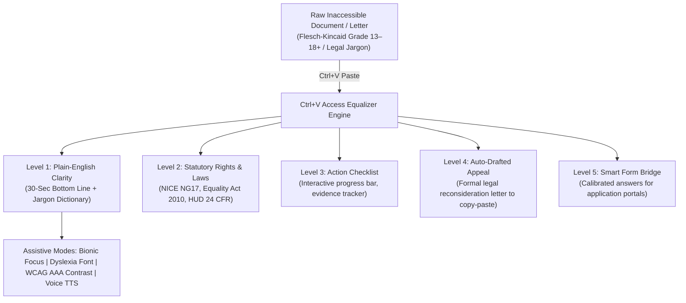

# 📋 Ctrl+V Access
### *The Instant AI Equalizer for Inaccessible Bureaucracy*

> **Built for the Ctrl+V Hackathon by ADHAYAN (November 2026)**  
> **Theme:** Use AI & technology to improve access (healthcare, disability accessibility, education, civil rights, civic services).  
> **Tagline:** "Ctrl+V" = Transfer information fast → help people reach the services, rights, and care they need faster.

[](https://www.w3.org/WAI/standards-guidelines/wcag/)
[](https://www.typescriptlang.org/)
[](https://react.dev/)
[](https://tailwindcss.com/)
[](LICENSE)

---

## 🎯 The Problem

Every day, millions of people with cognitive disabilities, low reading literacy, neurodivergence (ADHD, autism, dyslexia), non-native English speakers, elderly citizens, and vulnerable individuals face the **Administrative Wall**:

1. **Healthcare Denials:** Dense clinical letters refusing continuous glucose monitors, specialized cancer therapies, or mental health authorizations citing obscure clauses (*ICD-10 codes, exceptionality thresholds, contraindicated protocols*).
2. **Disability Benefits Gatekeeping:** Assessment decisions (e.g. PIP, SSI/SSDI) awarding 0 points simply because the claimant answered a 30-minute phone call without slurring words, ignoring years of medical evidence and severe neuropathic pain.
3. **University Accommodation Denials:** Higher-education disability offices refusing exam time concessions and assistive software by enforcing arbitrary "36-month recency" rules on permanent neurological conditions (ADHD, dyslexia).
4. **Housing & Civil Subsidy Terminations:** Local housing authorities issuing termination notices for rental assistance (Section 8 / HCV) due to minor paperwork deadlines while omitting due process hearing protections.

The administrative burden is not an accident—it is designed to discourage appeals. **65% of UK PIP disability benefit decisions that reach a tribunal hearing are overturned** ([DWP PIP Official Statistics to April 2026](https://www.gov.uk/government/statistics/personal-independence-payment-statistics-to-april-2026/personal-independence-payment-official-statistics-to-april-2026), Table 5Aii), yet only about 7% of initial decisions are ever appealed.

---

## ⚡ The Solution: Ctrl+V Access

**Ctrl+V Access** turns the universal computer shortcut—**Ctrl+V (Paste)**—into an instant assistive bridge. 

Whenever a user encounters an intimidating document, letter, email, or application portal question:
1. They press **`Ctrl+V`** (or `Cmd+V`) anywhere on the screen.
2. The **Equalizer Engine** instantly parses the document and delivers a 5-tier accessible transformation:



---

## 🚀 Key Features

### 1. Dual Entry: Global Ctrl+V Clipboard & Statutory Rights Search
- **Global Keyboard Paste (`Ctrl+V` / `⌘+V`):** Paste any document or denial notice anywhere on screen for instant parsing and equalizing.
- **Statutory Rights Search Engine:** Search a verified database of citizen rights, regulations, and entitlements (NICE guidelines, PIP scoring regulations, Equality Act accommodations, HUD fair housing rules, free prescription exemptions, and Access to Work grants) by keyword, condition, or government body.

### 2. Multi-Tier Equalizer Architecture
- **Level 1: Plain English:** Strips bureaucratic padding and shows the Flesch-Kincaid grade of the original and of the summary, both computed live by the same formula (e.g., NHS denial: Grade 18+ down to Grade 1). Surfaces a 30-second bottom line and a demystified jargon dictionary.
- **Level 2: Statutory Rights Discovery:** Identifies the governing statutory framework (e.g. *NHS Constitution*, *NICE Guideline NG17*, *Equality Act 2010 Part 6*, *HUD 24 C.F.R. § 982.555*) and highlights hidden entitlements (e.g. automatic stay of eviction, free prescription exemption, companion passes).
- **Level 3: Action Roadmap & Progress Meter:** Checkable step-by-step resolution tasks with required document tags and exportable checklist.
- **Level 4: Auto-Drafted Appeal Letter:** Generates a formal, legally grounded appeal and reconsideration notice formatted with citations and placeholders, equipped with a 1-click accessible copy button (`modern-web-guidance` compliant).
- **Level 5: Smart Form Bridge:** Assists users applying through online government portals by decoding tricky disqualifier questions and providing legally calibrated responses to paste in.

### 2. Comprehensive Assistive UX
- **Bionic Reading Mode:** Bolds the initial 45% of every word, guiding saccadic eye movements and drastically reducing cognitive reading fatigue for ADHD and neurodivergent users.
- **Dyslexia-Optimized Typography:** Integrates specialized letter-spacing and clean sans-serif letterforms (Lexend).
- **WCAG AAA High-Contrast Mode:** 1-click toggle for high-contrast yellow-on-black color scheme exceeding AAA contrast thresholds.
- **Voice Audio Narration:** Browser-native Text-to-Speech (TTS) audio reader with play/pause, reset, rate control (0.85x to 1.5x), and live visual waveform.
- **Multilingual Support:** Language preference across 10 languages (English, Spanish, French, Arabic, Hindi, Ukrainian, Urdu, Bengali, Chinese, Portuguese). It is passed to the Gemini engine for translated output when an API key is configured, in line with sponsor Adaption Platform's multilingual goals.
- **Universal Keyboard Navigation:** Global `Ctrl+V` paste listener, full focus rings, ARIA live regions, and semantic landmarks.

---

## 🧪 Real-World Benchmark Scenarios

The platform includes 4 authentic, pre-loaded case studies for instant 1-click evaluation:

| Scenario | Issuing Authority | FK Grade (original → summary) | Primary Legal Protection |
|:---|:---|:---:|:---|
| **NHS Glucose Monitor Denial** | Integrated Care Board (ICB) | 18+ → 1 | NICE Guideline NG17 (Rec 1.6.10) & NHS Constitution |
| **PIP Disability 0-Points Award** | Dept for Work & Pensions (DWP) | 13 → 2.2 | Regulation 4(2A) Reliability Test & UT Case UKUT 0540 |
| **University Exam Accommodation Denial** | Central Accommodations Panel | 18+ → 1 | Equality Act 2010 (Section 20 & 91: Reasonable Adjustments) |
| **Housing Voucher Subsidy Termination** | Metropolitan Housing Authority | 12.5 → 1.7 | HUD 24 C.F.R. § 982.555 & Goldberg v. Kelly Due Process |

---

## 🛠️ Tech Stack & Full-Stack Architecture

### Frontend
- **Framework:** React 18, TypeScript 5.7, Vite 6
- **Styling:** Tailwind CSS, PostCSS, Autoprefixer
- **Icons & Accessibility:** Lucide React, WAI-ARIA 1.2 compliant semantics
- **Audio:** Web Speech Synthesis API
- **Clipboard:** Asynchronous Clipboard API (`navigator.clipboard`) with WCAG-compliant live status regions

### Backend & AI Engine
- **Server:** Node.js, Express, CORS, TypeScript (`server/index.ts`)
- **AI Models:** Google Gemini 3.8 Flash via official `@google/genai` SDK
- **Offline Fallback:** Hybrid algorithmic NLP & Flesch-Kincaid formula calculator
- **REST Endpoints:**
  - `GET /api/health`: Health status and active LLM configuration
  - `POST /api/analyze`: Dual-engine multi-tier equalization
  - `POST /api/rights/search`: Statutory rights search engine
  - `POST /api/appeal/generate`: Custom petition drafting service
  - `POST /api/adaption/dataset`: Sample benchmark records in a dataset format (static sample data; no live Adaption Platform API call)

### Tooling & Automation
- **Testing & Recording:** Playwright, Chrome DevTools Protocol, FFmpeg

---

## 🏁 Quick Start

```bash
# Clone the repository
git clone https://github.com/shahaman098/ctrl-v-access.git
cd ctrl-v-access

# Install dependencies
npm install

# Start Backend API server (Port 3001)
npm run server

# In a separate terminal, start Frontend (Port 3000)
npm run dev

# Or build & preview full production stack
npm run build
npm run preview
```

Open [http://localhost:4173](http://localhost:4173) in your browser.

---

## 👥 Author

- **Kris (Aman Kumar Sah)** — Solo submission for **Ctrl+V Hackathon** (ADHAYAN)
- GitHub: [@shahaman098](https://github.com/shahaman098)
- Devpost: [`shahaman098`](https://devpost.com/shahaman098)
