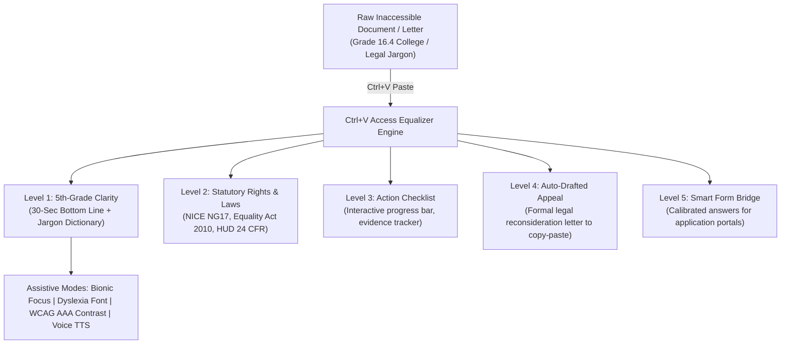

# 📋 Ctrl+V Access
### *The Instant AI Equalizer for Inaccessible Bureaucracy*

> **Built for the Ctrl+V Hackathon by ADHAYAN (November 2026)**  
> **Theme:** Use AI & technology to improve access (healthcare, disability accessibility, education, civil rights, civic services).  
> **Tagline:** "Ctrl+V" = Transfer information fast → help people reach the services, rights, and care they need faster.

[](https://www.w3.org/WAI/standards-guidelines/wcag/)
[](https://www.typescriptlang.org/)
[](https://react.dev/)
[](https://tailwindcss.com/)
[](LICENSE)

---

## 🎯 The Problem

Every day, millions of people with cognitive disabilities, low reading literacy, neurodivergence (ADHD, autism, dyslexia), non-native English speakers, elderly citizens, and vulnerable individuals face the **Administrative Wall**:

1. **Healthcare Denials:** Dense clinical letters refusing continuous glucose monitors, specialized cancer therapies, or mental health authorizations citing obscure clauses (*ICD-10 codes, exceptionality thresholds, contraindicated protocols*).
2. **Disability Benefits Gatekeeping:** Assessment decisions (e.g. PIP, SSI/SSDI) awarding 0 points simply because the claimant answered a 30-minute phone call without slurring words, ignoring years of medical evidence and severe neuropathic pain.
3. **University Accommodation Denials:** Higher-education disability offices refusing exam time concessions and assistive software by enforcing arbitrary "36-month recency" rules on permanent neurological conditions (ADHD, dyslexia).
4. **Housing & Civil Subsidy Terminations:** Local housing authorities issuing termination notices for rental assistance (Section 8 / HCV) due to minor paperwork deadlines while omitting due process hearing protections.

The administrative burden is not an accident—it is designed to discourage appeals. **Over 65% of bureaucratic benefit and treatment denials are overturned on appeal**, but fewer than 15% of recipients ever appeal because they cannot comprehend the hostile language or afford legal counsel.

---

## ⚡ The Solution: Ctrl+V Access

**Ctrl+V Access** turns the universal computer shortcut—**Ctrl+V (Paste)**—into an instant assistive bridge. 

Whenever a user encounters an intimidating document, letter, email, or application portal question:
1. They press **`Ctrl+V`** (or `Cmd+V`) anywhere on the screen.
2. The **Equalizer Engine** instantly parses the document and delivers a 5-tier accessible transformation:



---

## 🚀 Key Features

### 1. Multi-Tier Equalizer Architecture
- **Level 1: 5th-Grade Plain English:** Strips bureaucratic padding, calculating live Flesch-Kincaid grade level reduction (e.g., Grade 16.4 down to Grade 5.1). Surfaces a 30-second bottom line and a demystified jargon dictionary.
- **Level 2: Statutory Rights Discovery:** Identifies the governing statutory framework (e.g. *NHS Constitution*, *NICE Guideline NG17*, *Equality Act 2010 Part 6*, *HUD 24 C.F.R. § 982.555*) and highlights hidden entitlements (e.g. automatic stay of eviction, free prescription exemption, companion passes).
- **Level 3: Action Roadmap & Progress Meter:** Checkable step-by-step resolution tasks with required document tags and exportable checklist.
- **Level 4: Auto-Drafted Appeal Letter:** Generates a formal, legally grounded appeal and reconsideration notice formatted with citations and placeholders, equipped with a 1-click accessible copy button (`modern-web-guidance` compliant).
- **Level 5: Smart Form Bridge:** Assists users applying through online government portals by decoding tricky disqualifier questions and providing legally calibrated responses to paste in.

### 2. Comprehensive Assistive UX
- **Bionic Reading Mode:** Bolds the initial 45% of every word, guiding saccadic eye movements and drastically reducing cognitive reading fatigue for ADHD and neurodivergent users.
- **Dyslexia-Optimized Typography:** Integrates specialized letter-spacing and clean sans-serif letterforms (Lexend).
- **WCAG AAA High-Contrast Mode:** 1-click toggle for high-contrast yellow-on-black color scheme exceeding AAA contrast thresholds.
- **Voice Audio Narration:** Browser-native Text-to-Speech (TTS) audio reader with play/pause, reset, rate control (0.85x to 1.5x), and live visual waveform.
- **Multilingual Support:** Instant language switching across 10 global languages (English, Spanish, French, Arabic, Hindi, Ukrainian, Urdu, Bengali, Chinese, Portuguese), aligning with the Adaption platform's multilingual accessibility goals.
- **Universal Keyboard Navigation:** Global `Ctrl+V` paste listener, full focus rings, ARIA live regions, and semantic landmarks.

---

## 🧪 Real-World Benchmark Scenarios

The platform includes 4 authentic, pre-loaded case studies for instant 1-click evaluation:

| Scenario | Issuing Authority | Original Grade | Primary Legal Protection |
|:---|:---|:---:|:---|
| **NHS Glucose Monitor Denial** | Integrated Care Board (ICB) | Grade 16.4 | NICE Guideline NG17 (Rec 1.6.10) & NHS Constitution |
| **PIP Disability 0-Points Award** | Dept for Work & Pensions (DWP) | Grade 15.8 | Regulation 4(2A) Reliability Test & UT Case UKUT 0540 |
| **University Exam Accommodation Denial** | Central Accommodations Panel | Grade 14.9 | Equality Act 2010 (Section 20 & 91: Reasonable Adjustments) |
| **Housing Voucher Subsidy Termination** | Metropolitan Housing Authority | Grade 15.5 | HUD 24 C.F.R. § 982.555 & Goldberg v. Kelly Due Process |

---

## 🛠️ Tech Stack

- **Framework:** React 18, TypeScript 5.7, Vite 6
- **Styling:** Tailwind CSS, PostCSS, Autoprefixer
- **Icons & Accessibility:** Lucide React, WAI-ARIA 1.2 compliant semantics
- **Audio:** Web Speech Synthesis API
- **Clipboard:** Asynchronous Clipboard API (`navigator.clipboard`) with WCAG-compliant live status regions
- **Testing & Tooling:** Playwright, Chrome DevTools Protocol, FFmpeg

---

## 🏁 Quick Start

```bash
# Clone the repository
git clone https://github.com/shahaman098/ctrl-v-access.git
cd ctrl-v-access

# Install dependencies
npm install

# Start local development server
npm run dev

# Build for production
npm run build

# Preview production build
npm run preview
```

Open [http://localhost:4173](http://localhost:4173) in your browser.

---

## 👥 Author

- **Kris (Aman Kumar Sah)** — Solo submission for **Ctrl+V Hackathon** (ADHAYAN)
- GitHub: [@shahaman098](https://github.com/shahaman098)
- Devpost: [`shahaman098`](https://devpost.com/shahaman098)
