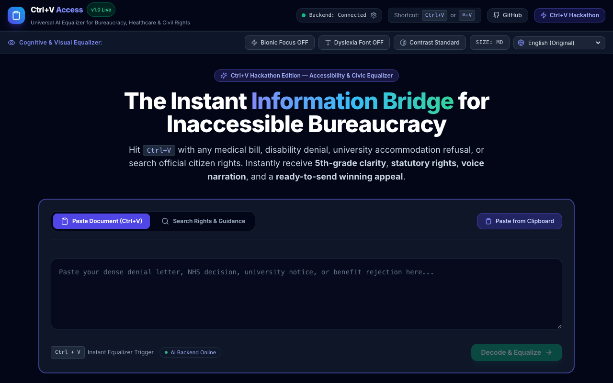
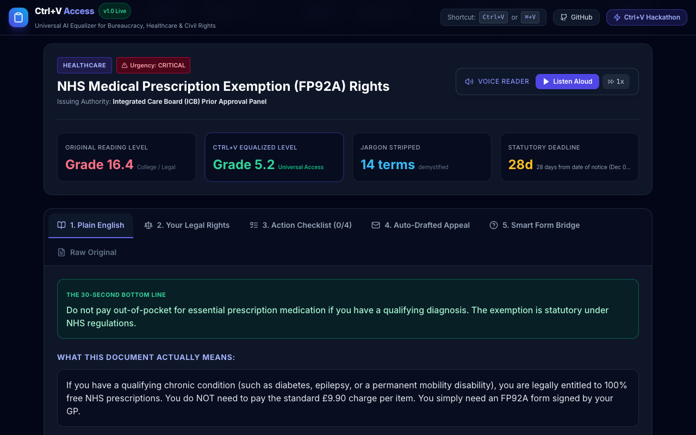
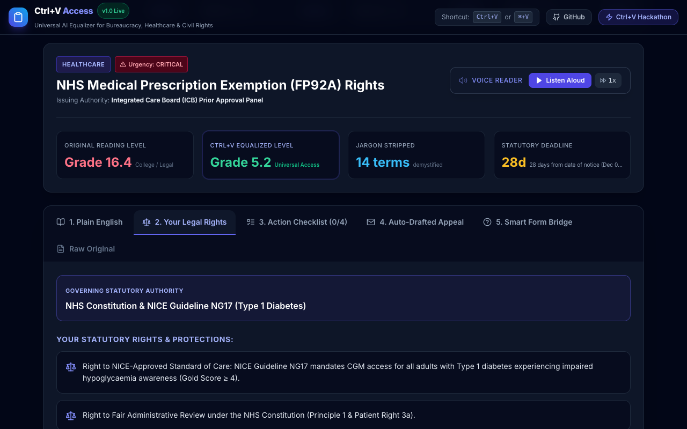
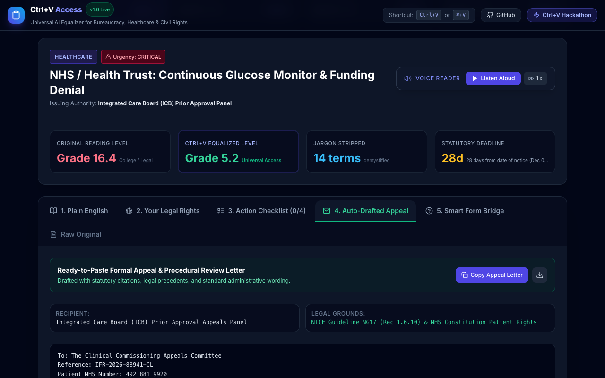
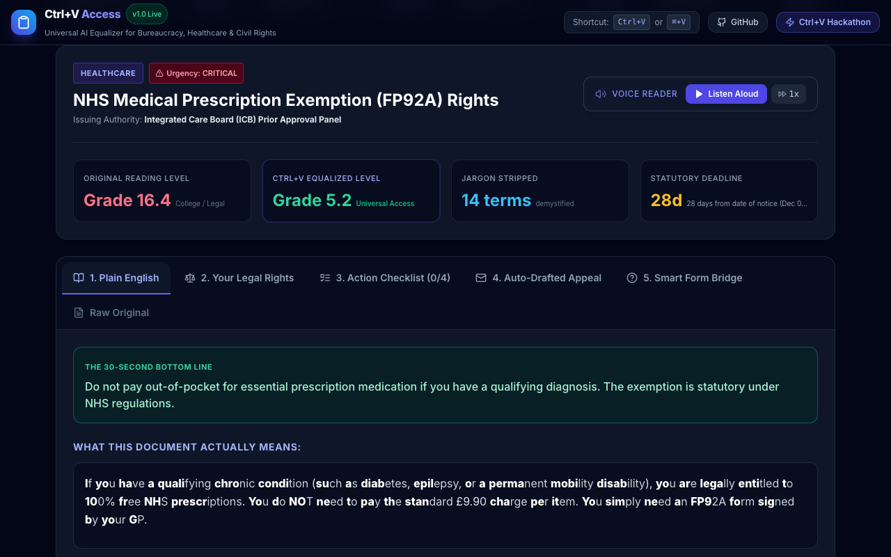
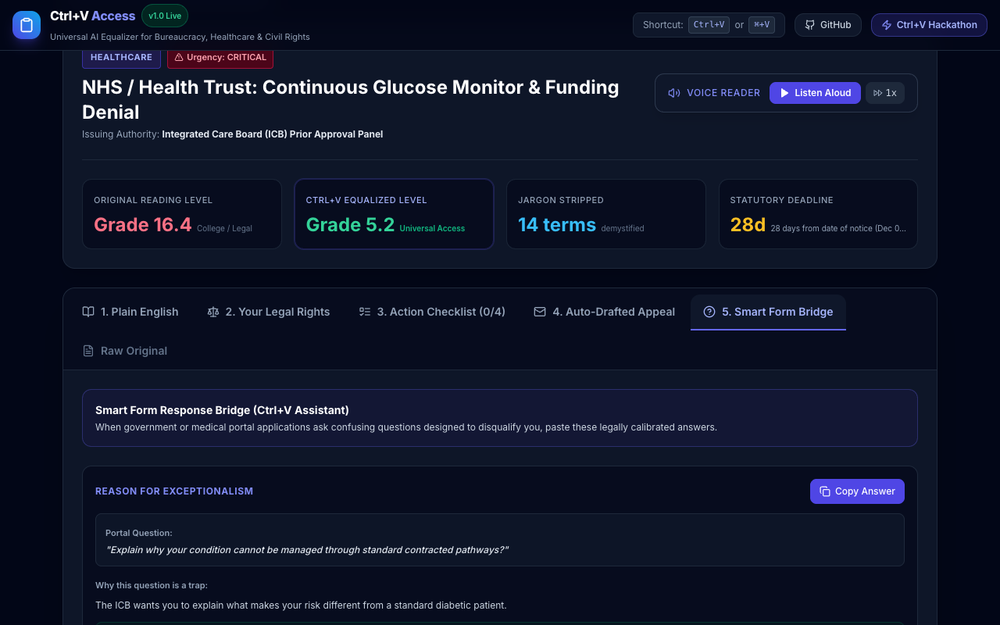
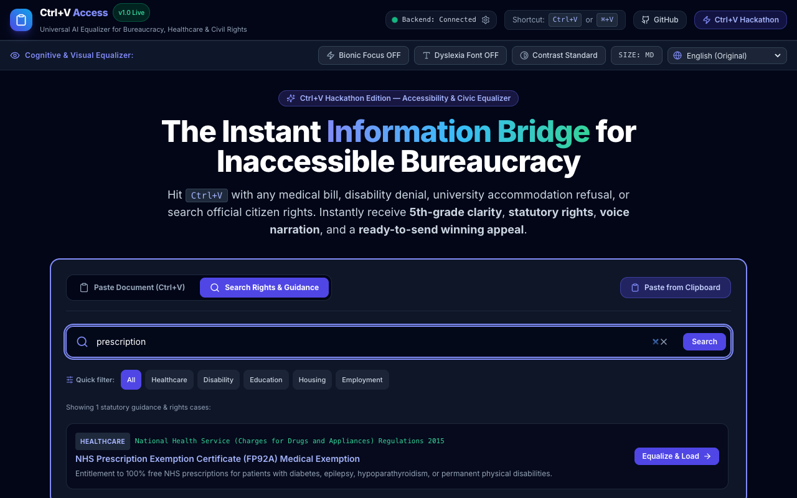

# Ctrl+V Access

Paste a bureaucratic denial. Get plain English, your legal rights, a checklist, and a draft appeal.

Built for the [Ctrl+V Hackathon](https://ctrl-v-hackathon-31831.devpost.com/) (ADHAYAN, Nov 2026). Solo builder: [Kris / shahaman098](https://github.com/shahaman098).

**Live repo:** https://github.com/shahaman098/ctrl-v-access  
**Demo video (1080p, ~2m 37s):** [`video/ctrl-v-access-final.mp4`](video/ctrl-v-access-final.mp4)

---

## Why this exists

UK PIP decisions that reach a tribunal are overturned **65% of the time** ([DWP PIP Official Statistics to April 2026](https://www.gov.uk/government/statistics/personal-independence-payment-statistics-to-april-2026/personal-independence-payment-official-statistics-to-april-2026), Table 5Aii). Most people never get that far — the notice is written at college/legal reading level, deadlines are buried, and the governing rule is never named.

Ctrl+V Access is a working prototype that turns **Ctrl+V / ⌘+V** into the equalizer: paste the letter, get something you can act on.

---

## What it actually does

| Layer | Output |
| --- | --- |
| 1 · Plain English | Bottom line, bullet takeaways, jargon → everyday words |
| 2 · Rights | Statutory citations (e.g. NICE NG17, Equality Act 2010, PIP Reg 4(2A), HUD 24 CFR § 982.555) |
| 3 · Checklist | Checkable steps + evidence to gather |
| 4 · Appeal draft | Formal reconsideration letter, one-click copy |
| 5 · Form bridge | Suggested answers for portal questions |

Assistive controls (always available):

- **Bionic Focus** — bold first ~45% of each word (`src/utils/bionic.tsx`)
- **Lexend** dyslexia-oriented typeface + letter spacing
- **High contrast** yellow-on-black toggle (built to AAA contrast ratios; not a third-party audit certificate)
- **Web Speech TTS** with rate control (`src/components/AudioPlayer.tsx`)
- Global paste listener + ARIA live status on clipboard actions

Two ways in:

1. Paste / Ctrl+V anywhere on the page  
2. **Search Rights** — curated statutory entries (healthcare, disability, education, housing, employment)

---

## Screenshots

| | |
| --- | --- |
|  |  |
|  |  |
|  |  |
|  | |

---

## Measured evidence (not marketing grades)

Reading grades are computed by the same Flesch–Kincaid function the app uses (`calculateReadingGrade` in `src/utils/analyzer.ts`). Scenario grades are **not** hand-typed — they are derived from `rawText` and `plainEnglish` at load time (`src/data/scenarios.ts`).

Independent check against `textstat 0.7.13` is in [`video/evidence/benchmark.txt`](video/evidence/benchmark.txt):

| Scenario | Words (raw → plain) | FK app | FK textstat | Dale–Chall | Engine |
| --- | ---: | ---: | ---: | ---: | ---: |
| NHS CGM funding denial | 217 → 65 (−70%) | 18 → 1 | 19.9 → 1.6 | 14.9 → 6.3 | 0.17 ms |
| DWP PIP 0-points award | 280 → 72 (−74%) | 13 → 2.2 | 13.4 → 2.0 | 11.8 → 6.5 | 0.11 ms |
| University DSA / exam time refusal | 182 → 73 (−60%) | 18 → 1 | 19.2 → 1.2 | 14.4 → 5.6 | 0.09 ms |
| Section 8 voucher termination | 211 → 63 (−70%) | 12.5 → 1.7 | 17.5 → 1.8 | 13.8 → 5.8 | 0.08 ms |

Primary citations wired into those four cases:

| Case | Authority |
| --- | --- |
| NHS CGM | NICE NG17 Rec 1.6.10 · NHS Constitution |
| PIP | Social Security (PIP) Regulations 2013 Reg 4(2A) |
| University | Equality Act 2010 Part 6 (§20 / §91) |
| Housing | HUD 24 C.F.R. § 982.555 · due-process hearing stay |

Rights search ships **7** curated entries (4 scenarios + FP92A prescription exemption, Access to Work, Warm Home Discount) in `src/data/searchDatabase.ts`.

Backend smoke test (captured in [`video/evidence/terminal.txt`](video/evidence/terminal.txt)):

```text
GET  /api/health   → 200 · ~2.2 ms · hybrid-local-nlp when no Gemini key
POST /api/analyze  → 200 · ~1.4 ms · source: local-hybrid-nlp
```

---

## Architecture (honest)

```
Browser (React 18 + TypeScript + Vite + Tailwind)
    │  Ctrl+V / paste / search
    ▼
Optional Express API (:3001) ──► Gemini (@google/genai) if API key set
    │                              else rule-based NLP in src/utils/analyzer.ts
    ▼
Always-available client fallback (same analyzer) if the API is down
```

| Piece | What is real |
| --- | --- |
| Offline equalizer | Flesch–Kincaid + jargon patterns + category heuristics + appeal scaffolding — works with **no** API key |
| Gemini path | Optional via `.env` (`GEMINI_API_KEY`) or the nav diagnostics panel (`localStorage`). Default model: `gemini-3.5-flash-lite` (falls back from `gemini-3.8-flash` on 503). Reading grades on this path are measured server-side with the same `calculateReadingGrade`, not reported by the model |
| `/api/adaption/dataset` | Static sample payload shaped like a dataset response. **Not** a live Adaption Platform / AutoScientist integration |
| Languages | 10-language preference control. Live translation of outputs needs the Gemini path; offline mode stays English |

REST surface (`server/index.ts`):

- `GET /api/health`
- `POST /api/analyze`
- `POST /api/rights/search`
- `POST /api/appeal/generate`
- `POST /api/adaption/dataset` (sample data only)

---

## Run it

```bash
git clone https://github.com/shahaman098/ctrl-v-access.git
cd ctrl-v-access
npm install

# Terminal A — API (optional; UI falls back offline)
npm run server          # http://localhost:3001

# Terminal B — UI
npm run dev             # http://localhost:3000

# Production build
npm run build && npm run preview   # http://localhost:4173
```

Optional: set `GEMINI_API_KEY` in a local `.env` for the server, or paste a key in the in-app diagnostics panel.

---

## Repo map

```
src/
  components/     PasteHero, AnalysisView, AccessibilityBar, AudioPlayer, …
  data/           scenarios.ts (4 cases) · searchDatabase.ts (7 entries)
  utils/          analyzer.ts (FK + equalizer) · bionic.tsx
  services/       api.ts (backend + client fallback)
server/           Express API
screenshots/      7 PNGs used above
video/
  ctrl-v-access-final.mp4
  DEMO_SCRIPT.md
  evidence/       benchmark.txt · terminal.txt
scripts/          screenshot + demo capture helpers
DEVPOST_SUBMISSION.md
```

Stack in `package.json`: React 18.3, TypeScript 5.7, Vite 6, Tailwind 3.4, Express 5, `@google/genai`, Lucide, Web Speech / Clipboard APIs.

---

## Limits (so judges aren’t surprised)

- Prototype, not legal advice. Citations are starting points; verify before filing.
- Benchmark letters are realistic composites, not scanned case files from named individuals.
- Without Gemini, arbitrary paste still returns a structured analysis, but it is heuristic — the four scenarios are the polished path.
- No automated WCAG conformance report is claimed; the UI implements landmarks, focus rings, live regions, and a high-contrast mode.

---

## Author

**Kris (Aman Kumar Sah)** — solo · Ctrl+V Hackathon (ADHAYAN)  
GitHub: [@shahaman098](https://github.com/shahaman098) · Devpost: [shahaman098](https://devpost.com/shahaman098)
